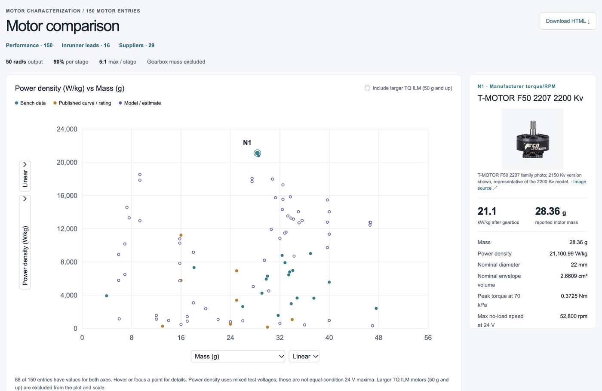

# Motor comparison

[Open motor comparison](https://qwertpas.github.io/motor-comparison/)

Compare motors by mass, size, speed, torque, motor constant, copper loss, and power density.

1. Choose a metric for each axis and select linear or logarithmic scales.
2. Adjust voltage, stress, or motor torque when those controls appear.
3. Select a motor to see its specifications, sources, and calculation assumptions.

Calculated values are estimates; check the source specifications for your operating conditions.
